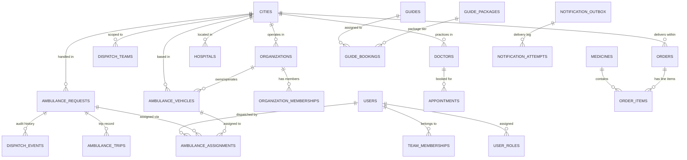

# Medizaai — Data Model Specification

## 1. Relational Entity Overview

---

## 2. Table Specifications

### 2.1 Core Platform & Multitenancy
- `cities`: Multi-city foundation (id, name, slug, is_active, timestamps).
- `organizations`: Medizaai parent org + private ambulance partners (id, city_id, name, type, phone, email, is_active).
- `organization_memberships`: Ties staff users to specific partner organizations.
- `users`: Staff accounts (id, name, phone, email, password_hash, is_active).
- `roles`: System roles (`SUPER_ADMIN`, `CITY_ADMIN`, `DISPATCHER`, `FLEET_MANAGER`, `PARTNER_COORDINATOR`, `PHARMACY_OPERATOR`).
- `user_roles`: Many-to-many relationship scoping users to roles and optional city boundaries.
- `dispatch_teams` & `team_memberships`: Dispatch teams tied to specific cities for dispatcher routing.

### 2.2 Healthcare Services
- `doctors`: Directory of physicians (id, city_id, name, specialty, qualifications, experience_years, consultation_fee, video_fee, photo_url, is_active).
- `appointments`: Booking intake records (id, doctor_id, city_id, customer_name, customer_phone, preferred_date, preferred_time_slot, status, notes).
- `guides`: In-person hospital guides (id, city_id, name, phone, languages, is_active).
- `guide_packages`: Fixed tiers `NORMAL`, `EXTRA`, `PREMIUM` (id, tier, title, description, price, is_active).
- `guide_bookings`: Bookings for guides (id, city_id, package_id, assigned_guide_id, customer_name, customer_phone, preferred_date, hospital_name, status).
- `hospitals`: Healthcare facilities & diagnostic centers (id, city_id, name, category, address, contact_phone, emergency_phone, services, is_active).

### 2.3 Pharmacy
- `medicines`: Medicine catalog with stock & pricing (id, name, generic_name, manufacturer, dosage_form, strength, price, stock_quantity, is_prescription_required, is_active).
- `orders`: Order heads (id, city_id, customer_name, customer_phone, delivery_address, subtotal, delivery_fee, total, status, payment_method, notes).
- `order_items`: Order line items with price snapshots (id, order_id, medicine_id, medicine_name_snapshot, unit_price_snapshot, quantity, line_total).

### 2.4 Emergency Ambulance Dispatch
- `ambulance_vehicles`: Ambulance fleet (id, city_id, organization_id, registration_number, vehicle_type, ownership_type, status, driver_name, driver_phone).
- `ambulance_requests`: Intake calls (id, reference_code, city_id, caller_name, caller_phone, pickup_address, destination_address, urgency, status, patient_notes, idempotency_key).
- `ambulance_assignments`: Vehicle offers & confirmations (id, request_id, vehicle_id, assigned_by_user_id, status, assigned_at, responded_at, completed_at).
- `ambulance_trips`: Execution details (id, request_id, vehicle_id, started_at, ended_at, trip_notes).
- `dispatch_events`: Full lifecycle event sourcing log (id, request_id, event_type, actor_user_id, payload, created_at).

### 2.5 Reliability, Settings & Audit
- `notification_outbox`: Reliable asynchronous messaging queue (id, channel, recipient, payload, status, attempts, max_attempts, last_error, scheduled_for, processed_at).
- `notification_attempts`: Detailed delivery attempt audit trail (id, outbox_id, channel, error, attempted_at).
- `settings`: Configurable business keys e.g. delivery fee, minimum order value (key, value, description, updated_at).
- `audit_logs`: Tamper-evident admin audit history (id, user_id, action, entity_type, entity_id, city_id, metadata, created_at).
